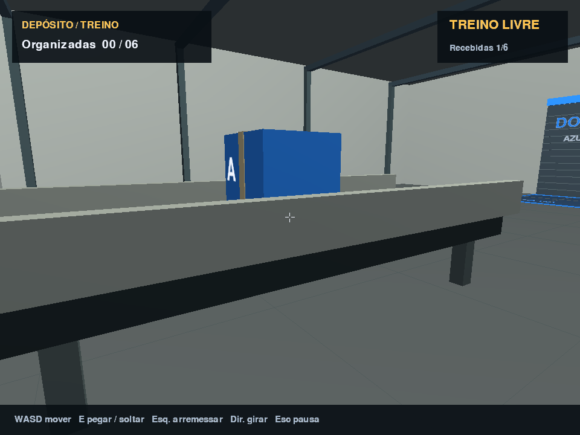

# Depósito — Simulador 3D

Jogo de organização de depósito em **Python + OpenGL**, com câmera em primeira pessoa
e física própria. Receba caixas pela esteira e organize-as nos retângulos da mesma cor.
Você pode pegar, transportar, girar, empilhar e arremessar as caixas. As portas de galpão
representam docas de expedição e são cenográficas.



## Executar no Windows

Na pasta do projeto, crie o ambiente e instale as duas dependências:

```powershell
py -3 -m venv .venv
.\.venv\Scripts\python.exe -m pip install -r requirements.txt
.\.venv\Scripts\python.exe main.py
```

O ambiente `.venv` deste computador já foi preparado. Para jogar agora, basta o último
comando. Não é necessário ativar o ambiente virtual nem modificar a política do PowerShell.

Em Linux/macOS, use Python 3.10 ou superior, `python3 -m venv .venv`,
`.venv/bin/python -m pip install -r requirements.txt` e `.venv/bin/python main.py`.
A nova versão foi verificada graficamente apenas no Windows. É necessária uma sessão
gráfica com suporte ao pipeline fixo do OpenGL 2.1. Não exige NumPy, GLUT ou modelos externos.

## Jogar

No menu, escolha `1` treino, `2` fácil, `3` médio, `4` difícil ou `5` laboratório de física.
As categorias usam cor e letra: A azul, B laranja, C verde, D violeta, E amarelo.

| Entrada | Ação |
| --- | --- |
| WASD | Caminhar. |
| Mouse | Olhar ao redor. |
| E | Pegar a caixa próxima sob a mira ou soltar a caixa segurada. |
| Segurar e soltar botão esquerdo | Carregar força e arremessar a caixa segurada. |
| Segurar botão direito e mover mouse | Girar a caixa segurada. |
| Esc | Pausar/retomar; no menu principal, sair. |
| F3 | Mostrar volumes e normais de contato, FPS e subdivisões físicas. |

A pausa libera o mouse. Perder o foco da janela também pausa. Na pausa ou resultado:
`R` repete, `M` volta ao menu, `Q` sai. `Enter` retoma a pausa, repete a derrota ou
avança após vitória. O último nível pode ser repetido.

A esteira para de emitir quando seu ponto de entrada está ocupado. Libere o espaço
para receber o restante do lote. A faixa transporta as caixas por contato físico.

Uma caixa conta como organizada quando está **inteira na área da mesma cor**, estável
por 0,75 segundo e apoiada no piso ou em caixas válidas da mesma categoria. Uma caixa
voando sobre a área não conta. Derrubar a pilha pode reduzir a contagem. Organizar todo
o lote por dois segundos conclui a tarefa. É permitido espalhar caixas dentro da área
ou empilhá-las; não há exigência de altura mínima.

| Modo | Cores | Caixas | Prazo | Intervalo de chegada |
| --- | --- | --- | --- | --- |
| Treino | 2 | 6 | Livre | 6 s |
| Fácil | 2 | 6 | 180 s | 6 s |
| Médio | 3 | 12 | 240 s | 5 s |
| Difícil | 5 | 20 | 300 s | 4 s |

O laboratório oferece pilha e caixa em queda, sem prazo. Use-o para experimentar
impactos e arremessos com F3. Os tempos e a força de arremesso ainda são parâmetros
iniciais de equilíbrio.

## Código e testes

`main.py` inicia a aplicação. O pacote `deposito/` separa matemática, corpos, colisões,
resposta física, jogador, cenário, esteira, regras, níveis, aplicação e renderização.
As unidades físicas são metros, segundos e quilogramas. O código usa nomes em português
e comentários nas fórmulas e decisões de simulação.

```powershell
# Testes de regras e física; funcionam apenas com a biblioteca padrão.
python -B -m unittest discover -s tests -v

# Integração OpenGL: abre janela temporária e atualiza capturas/simulador/.
.\.venv\Scripts\python.exe tests\verificar_simulador.py
```

O simulador usa SAT para colisões entre caixas orientadas, contatos de face/aresta,
impulsos com rotação e atrito, passo fixo de 120 Hz, subdivisão e repouso de pilhas.
A geometria de colisão corresponde aos blocos desenhados.

A física é um experimento didático: o orçamento é de até 20 caixas e os testes cobrem
casos definidos de empilhamento, queda e impacto. Muitas colisões simultâneas podem
reduzir o desempenho. Não há detecção contínua geral, e aumentar velocidades ou reduzir
espessuras exige novas verificações. Leia as [evidências e limitações](docs/implementacao-simulador.md).

## Documentação e versão anterior

- [Documentação em /docs](docs/README.md).
- [Plano da primeira experiência](docs/plano-primeira-experiencia.md).
- [Implementação e verificação](docs/implementacao-simulador.md).
- [Estado anterior ao simulador](docs/estado-atual.md).
- [README da versão anterior](README-legado.md).

A versão 2D com cena 3D independente continua disponível com `python legado.py`.
Seus testes gráficos estão em `tests/verificar_grafico.py`; os testes de lógica anteriores
permanecem na suíte. O simulador novo não usa as regras 2D.
